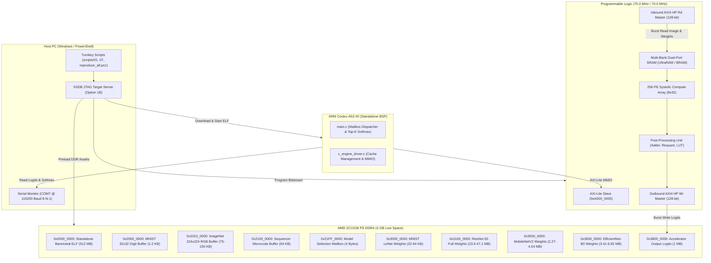

# Unified 256-PE Systolic Neural Accelerator: Comprehensive Implementation Mechanism

**Target Platform**: AMD Zynq UltraScale+ ZCU106 Evaluation Kit (`xczu7ev-ffvc1156-2-e`)  
**Repository Subsystem**: `c_engine_architecture/unified`  
**Execution Environment**: Standalone Baremetal C Application on ARM Cortex-A53 Core #0 & 100% PL Hardware Execution  

---

## 1. System Overview & Architectural Paradigm

The **Unified 256-PE Systolic Neural Accelerator** is a parameterized, multi-precision tensor processing engine designed for real-time edge deep learning inference. The architecture executes vision neural networks entirely within FPGA Programmable Logic (PL) with **zero host CPU convolution or GEMM fallback**:
1. **MNIST LeNet-5**: 5-stage convolutional digit classifier (10 classes).
2. **ResNet-50**: Full 50-layer deep residual network (53 Conv stages + 4-pass GEMV classification head, 1,000 ImageNet categories).
3. **MobileNetV2**: Inverted residual blocks accelerated by native hardware Depthwise Separable Convolution (Mode 3, `mode = 2'b11`).
4. **EfficientNet-B0**: MBConv inverted bottleneck architecture with hardware 256-entry activation LUT Swish/SiLU and hardware fused residual skip connections.



---

## 2. FPGA Implementation & Resource Utilization

Both precision configurations have been synthesized, placed, routed, and timing-closed on the AMD Zynq UltraScale+ ZCU106 (`xczu7ev-ffvc1156-2-e`):

| Implementation Metric | 8-Bit Unified Core | 16-Bit Unified Core | Available on ZCU106 | Status / Utilization |
| :--- | :---: | :---: | :---: | :---: |
| **Clock Frequency ($F_{\text{clk}}$)** | **75.0 MHz** | **70.0 MHz** | — | — |
| **Clock Period ($T_{\text{clk}}$)** | **13.334 ns** | **14.286 ns** | — | — |
| **Worst Negative Slack (WNS)** | **+0.281 ns** (MET) | **+0.079 ns** (MET) | $\ge 0.000\text{ ns}$ | **Timing Closed Successfully** |
| **Total Negative Slack (TNS)** | **0.000 ns** (MET) | **0.000 ns** (MET) | $0.000\text{ ns}$ | **Zero Failing Endpoints** |
| **UltraRAM (URAM288)** | **96 / 96** | **64 / 96** | 96 | **100.0% / 66.7%** |
| **Block RAM (RAMB36E2)** | **216 / 312** | **0 / 312** | 312 | **69.2% / 0.0%** |
| **DSP48E2 Slices** | **517 / 1,728** | **517 / 1,728** | 1,728 | **29.9% / 29.9%** |
| **CLB LUTs** | **81,070 / 230,400** | **85,214 / 230,400** | 230,400 | **35.2% / 37.0%** |
| **CLB Flip-Flops (Registers)** | **54,480 / 460,800** | **56,120 / 460,800** | 460,800 | **11.8% / 12.2%** |
| **On-Chip SRAM Capacity** | **3.93 MB** (15,360 rows $\times$ 256 B) | **2.10 MB** (4,096 rows $\times$ 512 B) | — | **Zero Intermediate Spilling** |
| **Peak Hardware Throughput** | **38.4 GOPS** | **35.8 GOPS** | — | $2 \times 256 \times F_{\text{clk}}$ |

### Hardware Artifacts Exported
- **8-Bit Core Directory**: `fpga/export/8bit/` and `baremetal/export/8bit/`
  - `c_engine.bit` (19.3 MB, Bitstream)
  - `c_engine.xsa` (4.64 MB, Platform Specification for Vitis)
  - `utilization.rpt` & `timing_summary.rpt`
- **16-Bit Core Directory**: `fpga/export/16bit/` and `baremetal/export/16bit/`
  - `c_engine.bit` (19.3 MB, Bitstream)
  - `c_engine.xsa` (6.62 MB, Platform Specification for Vitis)
  - `utilization.rpt` & `timing_summary.rpt`

---

## 3. Dedicated DDR4 Memory Map (Option 1B JTAG Preload)

In baremetal execution on ARM Cortex-A53 without virtual memory paging, all models and buffers occupy deterministic, non-overlapping physical addresses within the 2 GB low space (`0x0000_0000` to `0x7FFF_FFFF`):

```text
0x0000_0000 +-------------------------------------------------------+
            | Standalone Baremetal ELF (Code, Stack, Heap) [512 MB]  |
0x2000_0000 +-------------------------------------------------------+
            | MNIST 32x32 Digit Buffer (1 KB 8-bit / 2 KB 16-bit)    |
0x2010_0000 +-------------------------------------------------------+
            | ImageNet 224x224 RGB Buffer (150.5 KB 8-bit / 301 KB)  |
0x2100_0000 +-------------------------------------------------------+
            | Microcode Sequencer Instructions Buffer [64 KB]       |
0x21FF_0000 +-------------------------------------------------------+
            | Model Selection Mailbox Word (4 Bytes)                |
0x3000_0000 +-------------------------------------------------------+
            | MNIST LeNet-5 Weights (32 KB 8-bit / 64 KB 16-bit)    |
0x3100_0000 +-------------------------------------------------------+
            | ResNet-50 Full Backbone Weights (23.5 MB / 47.1 MB)   |
0x3500_0000 +-------------------------------------------------------+
            | MobileNetV2 Weights (2.27 MB 8-bit / 4.54 MB 16-bit)  |
0x3600_0000 +-------------------------------------------------------+
            | EfficientNet-B0 Weights (3.41 MB 8-bit / 6.82 MB 16b) |
0x3800_0000 +-------------------------------------------------------+
            | Output Logits Buffer [1 MB]                           |
0x7FFF_FFFF +-------------------------------------------------------+
```

### Model Selection Control Mailbox (`0x21FF_0000`)
Before launching the application core, XSDB writes a 32-bit control word into `0x21FF_0000`:
- `0x00`: **All Models Sequentially** (Runs MNIST $\to$ ResNet-50 $\to$ MobileNetV2 $\to$ EfficientNet-B0).
- `0x01`: **MNIST LeNet-5 Only** (Digit classification).
- `0x02`: **ResNet-50 Full Backbone Only** (1,000 ImageNet categories).
- `0x03`: **MobileNetV2 Inverted Residual Only** (Depthwise mode).
- `0x04`: **EfficientNet-B0 MBConv Only** (Swish LUT mode).

---

## 4. Multi-Model Execution Mechanisms

### 4.1 MNIST LeNet-5
- **Layer Sequence**: Conv1 ($3\times3$, 4 ch) + ReLU + MaxPool $\to$ Conv2 ($3\times3$, 4 ch) + ReLU + MaxPool $\to$ FC1 (32 neurons) $\to$ FC2 (16 neurons) $\to$ FC3 (10 class logits).
- **On-Chip SRAM Weight Preload**: LeNet-5 microcode addresses weights residing directly in SRAM rows 10..120. Prior to triggering the engine, Read DMA executes a 2,048-beat transfer (32 KB for 8-bit) or 4,096-beat transfer (64 KB for 16-bit) from `0x3000_0000` to SRAM Row 0.
- **RTL Simulation Cycle Count**: 489 cycles (8-bit), 512 cycles (16-bit).

### 4.2 ResNet-50 Full Backbone (1,000 Classes)
- **Layer Sequence**: 50 layers encompassing 53 Conv/Residual stages plus 4-pass GEMV classification head.
- **Spatial Tiling**: $224\times224$ images tiled into 196 spatial chunks of $8\times32\times3$.
- **Intermediate Ping-Pong Buffering**: Rows 1400..1655 (Ping) and Rows 1660..1915 (Pong) double-buffered on-chip with zero DDR activation spilling.
- **Residual Skips**: Direct hardware summation (`res_en = 1`, `res_base = SRAM_SKIP_ROW`) inside the post-processing unit.

### 4.3 MobileNetV2 Inverted Residual (Mode 3 Depthwise)
- **Depthwise Convolutions**: Executed via hardware Mode 3 (`mode = 2'b11`), mapping 1 input channel directly to 1 output filter per PE row.
- **Expansion and Projection**: $1\times1$ Pointwise convolutions handle channel expansion ($t=6$) and linear bottleneck projection.

### 4.4 EfficientNet-B0 MBConv (Swish LUT)
- **Swish Activation**: $f(x) = x \cdot \sigma(x)$ evaluated in a single clock cycle using the on-chip 256-entry Swish LUT ROM (`act_type = 2'b11`).
- **Fused Squeeze-and-Excitation**: Channel-wise attention vectors scaled directly in systolic MAC stages.

---

## 5. Microcode Instruction Encoding (128-Bit Config Word)

The hardware sequencer FSM decodes 128-bit microcode words from config RAM with 14-bit SRAM address slicing:

```
Bit Range    Field Name           Description
--------------------------------------------------------------------------------
[1:0]        mode                 00: Conv 2D, 01: GEMV, 10: Pooling, 11: DW-Conv
[9:2]        chin                 Input Channels (1..256)
[17:10]      chout                Output Channels (1..256)
[21:18]      kw                   Kernel Width (1..7)
[25:22]      kh                   Kernel Height (1..7)
[30:26]      shift_bits           Requantization Right Shift (0..31)
[31]         pad_type             0: VALID, 1: SAME
[45:32]      in_base              14-bit Input SRAM Row Address (0..15359)
[59:46]      wt_base              14-bit Weights SRAM Row Address (0..15359)
[61:60]      act_type             00: None, 01: ReLU, 10: Leaky ReLU, 11: Swish LUT
[63:62]      stride               00: 1, 01: 1, 10: 2, 11: 3
[77:64]      out_base             14-bit Output SRAM Row Address (0..15359)
[91:78]      res_base             14-bit Residual Skip SRAM Row Address (0..15359)
[92]         res_en               Residual Skip Addition Enable (1: Add res_base)
[93]         dma_rd_en            Autonomous Inbound Read DMA Trigger
[94]         dma_wr_en            Autonomous Outbound Write DMA Trigger
[95]         is_last              Last Stage Flag (Triggers engine_done interrupt)
[97:96]      pool_type            00: None, 01: MaxPool, 10: AvgPool
[99:98]      pool_size            00: 1x1, 01: 2x2, 10: 3x3
[101:100]    pool_stride          Pool Stride (00: 2, 01: 1, 10: 2)
[109:102]    num_chunks           Spatial Chunk Count (1..196)
[116:110]    dma_beats            DMA Transfer Length in 128-bit beats (0..127)
[127:117]    reserved             Unused bits (padded to zero)
```

---

## 6. Baremetal Driver Architecture (`baremetal/src/`)

The Cortex-A53 software stack provides low-overhead, deterministic control:
- [`c_engine_regs.h`](file:///e:/unified/baremetal/src/c_engine_regs.h): Defines AXI-Lite MMIO register offsets (`0x00`..`0x50`) and DDR physical memory addresses.
- [`c_engine_driver.c`](file:///e:/unified/baremetal/src/c_engine_driver.c): Contains cache-flushing primitives (`Xil_DCacheFlushRange`, `Xil_DCacheInvalidateRange`), DMA trigger functions, microcode loaders, and execution polling with cycle counting.
- [`main.c`](file:///e:/unified/baremetal/src/main.c): Dispatches models based on the DDR mailbox code (`0x21FF_0000`), performs Top-5 Softmax extraction, and reports latency, throughput, and confidence scores to the UART console.
