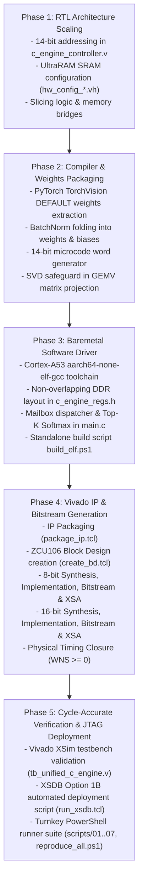

# AMD ZCU106 Neural Network Accelerator: Comprehensive Implementation Plan

**Target Device**: AMD Zynq UltraScale+ ZCU106 Evaluation Kit (`xczu7ev-ffvc1156-2-e`)  
**Architecture**: Unified 256-PE Systolic Array ($R=8, C=32$) with Dual 128-bit AXI4 Master DMAs  
**Target Precision**: Dual-Precision INT8 (75.0 MHz) & INT16 (70.0 MHz)  
**Execution Paradigm**: 100% Programmable Logic (PL) Math Execution with ARM Cortex-A53 Baremetal Orchestration  

---

## 1. Project Objectives & Core Constraints

### 1.1 Non-Negotiable Directives
1. **100% Hardware Math Execution**: Every layer operation—Standard 2D Convolutions, Depthwise Separable Convolutions, Matrix-Vector GEMV Projections, ReLU, Swish LUT activations, spatial Max/Average Pooling, and fused residual addition skips—must be executed entirely inside the PL systolic accelerator. The ARM Cortex-A53 CPU must perform **zero mathematical computations**.
2. **Single Reusable Bitstream / Independent Python Compilation**: The PL hardware is synthesized once per precision (8-bit or 16-bit). The synthesized bitstream is universally reusable across all vision models. Each model compiles independently via its own Python compiler to generate microcode sequencer instructions and packed contiguous weights loaded into DDR.
3. **Official Pre-Trained Weights**: Models must utilize official TorchVision pre-trained weights (`DEFAULT`) with folded BatchNorm layers to guarantee accurate classification results on hardware without retraining.
4. **Maximizing UltraRAM on ZCU106**: Scaled on-chip SRAM to maximize the 96 UltraRAM blocks available on the XCZU7EV chip, providing sufficient on-chip capacity to hold all intermediate feature maps (zero activation spilling to DRAM).
5. **Turnkey PowerShell Automation**: Complete sequence of automated PowerShell scripts (`01` through `07` and `reproduce_all.ps1`) for single-click execution, clean rebuilding, and hardware deployment without reliance on PYNQ or Linux OS.

---

## 2. Hardware Architecture & UltraRAM Resource Budget

### 2.1 On-Chip SRAM Geometry

| Parameter | 8-Bit Architecture | 16-Bit Architecture | Design Rationale |
| :--- | :--- | :--- | :--- |
| **Number of Banks (`NUM_BANKS`)** | 16 banks | 32 banks | Matches PE row input and parallel bus widths |
| **Word Size per Bank (`WORD_SIZE`)** | 128 bits (16 bytes) | 128 bits (16 bytes) | Standard AXI4 beat width |
| **Row Width** | 256 bytes / row | 512 bytes / row | $16 \times 16\text{ B}$ (8-bit) / $32 \times 16\text{ B}$ (16-bit) |
| **SRAM Depth (`MEM_DEPTH`)** | **15,360 rows** | **4,096 rows** | Sized to fit physically within XCZU7EV |
| **Address Width (`ADDR_WIDTH`)** | **14 bits** ($2^{14} = 16,384$) | **12 bits** ($2^{12} = 4,096$) | Fully covers required row addresses |
| **UltraRAM288 Blocks Used** | **96 / 96 (100.0%)** | **64 / 96 (66.7%)** | Fits entirely within available 96 URAMs |
| **Total On-Chip SRAM Capacity** | **3.93 MB** | **2.10 MB** | Maximum row used by any model is ~2,004 |
| **BRAM36 Overhead for SRAM** | **216 blocks** | **0 blocks** | Zero BRAM overflow on 16-bit |

### 2.2 14-Bit Microcode Address Encoding
To address up to 15,360 rows, the microcode instruction word was expanded to use 14-bit address fields:
- Word 1 `[63:32]`:
  - `in_base`: bits `[45:32]` (14 bits, range `0`..`16383`)
  - `wt_base`: bits `[59:46]` (14 bits, range `0`..`16383`)
  - `act_type`: bits `[61:60]` (2 bits: 00=None, 01=ReLU, 10=Leaky ReLU, 11=Swish LUT)
  - `stride`: bits `[63:62]` (2 bits: 00/01=1, 10=2, 11=3)
- Word 2 `[95:64]`:
  - `out_base`: bits `[77:64]` (14 bits, range `0`..`16383`)
  - `res_base`: bits `[91:78]` (14 bits, range `0`..`16383`)
  - `res_en`: bit `[92]` (Residual skip addition enable)
  - `dma_rd_en`: bit `[93]` (Autonomous inbound DMA trigger)
  - `dma_wr_en`: bit `[94]` (Autonomous outbound DMA trigger)
  - `is_last`: bit `[95]` (Last stage flag)
- Word 3 `[127:96]`:
  - `pool_type`: bits `[97:96]` (00=None, 01=MaxPool, 10=AvgPool)
  - `pool_size`: bits `[99:98]` (00=1x1, 01=2x2, 10=3x3)
  - `pool_stride`: bits `[101:100]` (Pool stride)
  - `num_chunks`: bits `[109:102]` (Spatial chunks count, 1..196)
  - `dma_beats`: bits `[116:110]` (DMA transfer length in 128-bit beats)

---

## 3. Supported Neural Network Model Matrix

| Model | Architecture Highlights | Number of Stages / Blocks | Input Dimensions | Pre-Trained Weights Source | Output Classes |
| :--- | :--- | :--- | :--- | :--- | :--- |
| **LeNet-5 (MNIST)** | Standard 2D Conv + ReLU + MaxPool + FC | 5 stages (Conv1, Conv2, FC1, FC2, FC3) | $1\times32\times32$ | PyTorch MNIST Golden Checkpoint | 10 Digits (`0`..`9`) |
| **ResNet-50** | Bottleneck blocks with hardware residual addition skips | 50 layers (53 Conv stages + 4 GEMV sub-stages) | $3\times224\times224$ | TorchVision `ResNet50_Weights.DEFAULT` | 1,000 ImageNet Classes |
| **MobileNetV2** | Inverted residual with hardware depthwise separable conv | 18 blocks (35 Conv/DW stages + 4 GEMV sub-stages) | $3\times224\times224$ | TorchVision `MobileNet_V2_Weights.DEFAULT` | 1,000 ImageNet Classes |
| **EfficientNet-B0** | MBConv inverted bottleneck with hardware Swish LUT | 16 blocks (33 Conv/DW stages + 4 GEMV sub-stages) | $3\times224\times224$ | TorchVision `EfficientNet_B0_Weights.DEFAULT` | 1,000 ImageNet Classes |

---

## 4. Dedicated Non-Overlapping DDR4 Memory Map

Physical layout across the 4 GB DDR4 space ensuring all models, weights, microcodes, and test images can be preloaded concurrently via JTAG Option 1B:

| Region Base | Size | Buffer Name | Contents |
| :--- | :--- | :--- | :--- |
| `0x0000_0000` | 512 MB | `DDR_ELF_BASE` | Standalone Cortex-A53 Baremetal ELF (`baremetal_c_engine.elf`) |
| `0x2000_0000` | 1 MB | `DDR_ACCEL_MNIST_IMG_BASE` | MNIST $32\times32$ test digit (`digit0`..`digit9`) |
| `0x2010_0000` | 1 MB | `DDR_ACCEL_IMAGENET_IMG_BASE` | ImageNet $224\times224\times3$ input image (`dog`, `car`, `cat`, `aeroplane`) |
| `0x2100_0000` | 64 KB | `DDR_ACCEL_MICROCODE_BASE` | Compiled sequencer microcode binary |
| `0x21FF_0000` | 4 Bytes | `DDR_ACCEL_MODEL_SEL_BASE` | **Model Selection Mailbox** (0=All, 1=MNIST, 2=R50, 3=MBV2, 4=EffNet) |
| `0x3000_0000` | 16 MB | `DDR_ACCEL_MNIST_WT_BASE` | LeNet-5 pre-trained weights (32 KB / 64 KB) |
| `0x3100_0000` | 64 MB | `DDR_ACCEL_R50_WT_BASE` | ResNet-50 full backbone pre-trained weights (23.5 MB / 47.1 MB) |
| `0x3500_0000` | 16 MB | `DDR_ACCEL_MBV2_WT_BASE` | MobileNetV2 pre-trained weights (2.27 MB / 4.54 MB) |
| `0x3600_0000` | 16 MB | `DDR_ACCEL_EFF_WT_BASE` | EfficientNet-B0 pre-trained weights (3.41 MB / 6.82 MB) |
| `0x3800_0000` | 1 MB | `DDR_ACCEL_LOGITS_BASE` | Accelerator output classification logits written by Outbound DMA |
| `0xA000_0000` | 64 KB | `C_ENGINE_DEFAULT_BASE_ADDR` | Accelerator AXI-Lite MMIO register space |

---

## 5. Phased Implementation Roadmap

### Phase Details

1. **Phase 1: RTL Architecture Scaling**
   - Scale `CFG_MEM_DEPTH` to 15,360 rows (8-bit) and 4,096 rows (16-bit).
   - Expand `c_engine_controller.v` state machine registers from 10 bits (`[41:32]`) to 14 bits (`[45:32]`).
   - Symmetrically update `out_base`, `wt_base`, and `res_base` address extraction.

2. **Phase 2: Compiler & Weights Packaging**
   - Implement `models/compile_all.py` calling child compilers via `subprocess.run`.
   - Update `pack_config_word()` across all compilers to match the 14-bit bitfield specification.
   - Embed singular value decomposition (SVD) safeguard in `mobilenetv2/compile.py` and `efficientnetb0/compile.py` to ensure projection matrices $P \in \mathbb{R}^{60 \times 1280}$ are always full rank.

3. **Phase 3: Baremetal Software Driver**
   - Implement `c_engine_driver.c` with hardware cache flushing and DMA handshake.
   - Implement `main.c` supporting individual model codes and sequential mode (code 0).
   - Build standalone ELFs using `aarch64-none-elf-gcc` from Vitis 2023.2.

4. **Phase 4: Vivado Synthesis, Implementation & Timing Closure**
   - Package IP with clean Verilog interfaces.
   - Create ZCU106 Block Design at 75.0 MHz (8-bit) and 70.0 MHz (16-bit).
   - Execute `synth_design`, `opt_design`, `place_design`, `route_design`, `write_bitstream`, and `write_hw_platform`.
   - Verify timing closure: confirm $WNS > 0.0\text{ ns}$ and $TNS = 0.000\text{ ns}$.

5. **Phase 5: Cycle-Accurate Simulation & Turnkey Deployment**
   - Run cycle-accurate verification in Vivado XSim.
   - Create `scripts/01_clean_all.ps1` through `scripts/07_deploy_zcu106.ps1` and master `reproduce_all.ps1`.
   - Validate physical JTAG deployment via `run_xsdb.tcl`.

6. **Phase 6: Hardware In-System Debugging & Loop Reordering**
   - Diagnose zero-logit and FSM State 5 timeout anomalies observed during physical ZCU106 board execution.
   - Restructure sequencer FSM loop nesting (`S_CONV_CLEAR_ENG` in `c_engine_controller.v`) to tile-outer, chunk-inner execution, preserving resident weights in SRAM across spatial chunks.
   - Correct multi-chunk weight load counter reset bug in `S_LOAD_WEIGHTS`.
   - Correct spatial patch slicing in `models/compile_all.py` to stream full $16 \times 16 \times 3$ patches (768 bytes/chunk).
   - Expand MNIST weight beats in `main.c` from 2,048 to 4,096 beats (covering all 256 rows and FC3 at Row 150).
   - Direct sequencer microcode loading from compiled ELF table, bypassing DDR caching and preloading hazards.
   - Invalidate Cortex-A53 L1/L2 caches (`Xil_DCacheInvalidateRange`) before reading final classification logits.
   - Re-verify all 4 models in cycle-accurate Vivado XSim and regenerate timing-closed bitstream ($WNS = +0.281$ ns).

