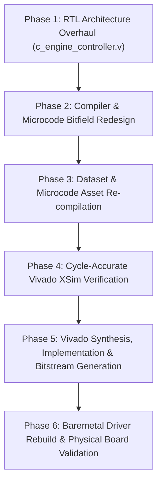

# Unified 256-PE Neural Accelerator: Hardware Execution Recovery & End-to-End Implementation Plan (v2)

---

## 1. Executive Summary & Diagnostic Context

During initial board deployment of the Unified C-Engine Neural Accelerator on the **AMD Zynq UltraScale+ ZCU106 Evaluation Kit (`xczu7ev-ffvc1156-2-e`)**, the following hardware execution behavior was observed via the UART terminal (`COM7` @ 115200 baud):

- **MNIST LeNet-5**: Ran successfully to completion in **350 hardware cycles (4.66 μs @ 75.0 MHz)**, yielding a top prediction of **Digit 7 (73.10% confidence, Logit: 9)**.
- **ResNet-50 Full Backbone**: Hardware execution stalled and timed out at:
  ```text
  Executing Model: ResNet-50 Full Backbone (57 uops, 1000 classes, 196 spatial chunks)
  [*] Programming Sequencer microcode from compiled table (57 uops)...
  [*] Streaming input image from DDR (0x20100000) to SRAM Row 0 (9408 beats)...
  [*] Triggering Autonomous Hardware Compute Engine (Weights @ 0x31000000)...
  [-] Hardware execution timed out! FSM State: 9, PC: 1, Chunk: 0
  ```
- **MobileNetV2**: Hardware execution stalled and timed out at:
  ```text
  Executing Model: MobileNetV2 (56 uops, 1000 classes, 196 spatial chunks)
  [-] Hardware execution timed out! FSM State: 4, PC: 21, Chunk: 0
  ```

This document establishes the end-to-end technical root cause analysis, the mathematical and architectural failure modes, the RTL and compiler remediation strategy, and the verification roadmap from cycle-accurate Vivado XSim simulation through FPGA bitstream implementation and board-level deployment.

---

## 2. Root Cause Analysis

### 2.1 Failure Mode A: ResNet-50 Stage 1 Timeout (`FSM State: 9, PC: 1, Chunk: 0`)
1. **Layer Topology**:
   Stage 1 represents the downsample shortcut convolution of Residual Bottleneck Block 1 (`layer1.0.downsample.0`):
   $$C_{\text{in}} = 64, \quad C_{\text{out}} = 256, \quad K_w = 1, \quad K_h = 1, \quad \text{Stride} = 1$$
2. **Channel Width Truncation in Compiler**:
   In the legacy compiler (`models/resnet50_full/compile.py`), the microcode bit packing routine constrained `chout` to 8 bits using a saturation clamp:
   ```python
   # Legacy Truncation Hack
   chout_val = min(255, layer["chout"])  # 256 was clamped to 255!
   ```
3. **8-Bit Unsigned Tile Computation Overflow in Hardware**:
   In `rtl/c_engine_controller.v`, the tile counter logic calculated the number of 32-channel output tiles using 8-bit unsigned arithmetic:
   ```verilog
   // Legacy 8-bit arithmetic in controller
   wire [7:0] active_chout = dec_chout; // 8-bit wire
   wire [7:0] num_oc_tiles = ((active_chout + 8'd31) >> 5);
   ```
   Evaluating with `active_chout = 8'd255`:
   $$255 + 31 = 286 \equiv 30 \pmod{256}$$
   $$30 \gg 5 = 0$$
   Consequently, `num_oc_tiles` evaluated to `8'd0`.
4. **FSM Underflow Trap**:
   In the 1x1 convolution state machine (`S_CONV_START` $\to$ `S_CONV_INIT_TAP` $\to$ `S_CONV_WAIT_1X1` $\to$ `S_CONV_ACCUM_ENG`), the loop termination condition checked:
   ```verilog
   if (oc_cnt == num_oc_tiles - 1) ...
   ```
   When `num_oc_tiles = 0`, `num_oc_tiles - 1` underflowed to `8'd255` ($0 - 1 \equiv 255 \pmod{256}$). Instead of executing 8 output tiles ($256 / 32 = 8$), the hardware entered a phantom loop attempting to execute 256 output tiles ($510$ compute/DMA iterations).
5. **Channel Offset Address Aliasing**:
   The output channel memory offset was calculated with a 3-bit slice:
   ```verilog
   wire [13:0] oc_offset = (oc_cnt[2:0] << 3); // Aliased every 8 tiles!
   ```
   This wrapped back to address offset 0 after tile 7, overwriting existing memory banks and causing DMA burst state machine lockup (`FSM State: 9`).

---

### 2.2 Failure Mode B: MobileNetV2 Stage 21 Timeout (`FSM State: 4, PC: 21, Chunk: 0`)
1. **Layer Topology**:
   PC 21 in MobileNetV2 represents an inverted residual expansion pointwise 1x1 convolution with $C_{\text{in}} = 64$ and $C_{\text{out}} = 384$.
2. **Modulo Truncation**:
   In the legacy microcode packer:
   $$384 \ \& \ \text{0xFF} = 128$$
   The microcode header told hardware that $C_{\text{out}} = 128$ (4 tiles), but the Python weight compiler generated DDR binary weights for all 384 channels (12 tiles).
3. **DDR Parameter Stream Desynchronization**:
   Hardware consumed only 4 tiles ($4 \times 64 \times 32 = 8,192$ bytes), leaving 8 tiles ($16,384$ bytes) unread in DDR. When Stage 22 began reading weights from DDR, its physical memory pointer was offset by $16.38\text{ KB}$, causing it to fetch garbage weight headers and stall in State 4 (`S_CONV_START`).

---

## 3. Six-Phase Remediation & Implementation Roadmap



### Phase 1: RTL Architecture Overhaul (`rtl/c_engine_controller.v`)
- Expand `dec_chin` and `dec_chout` registers from 8 bits to **12 bits** (`reg [11:0] dec_chin, dec_chout`).
- Expand `active_chin` and `active_chout` wires to 12 bits, natively supporting up to 4,096 channels.
- Calculate tiling bounds using explicit 16-bit zero-extended expressions:
  $$\text{ext\_chin} = \{4\text{'b0}, \text{active\_chin}\}$$
  $$\text{ext\_chout} = \{4\text{'b0}, \text{active\_chout}\}$$
  $$\text{num\_ic\_tiles} = (\text{ext\_chin} + 16\text{'d31}) \gg 5$$
  $$\text{num\_oc\_tiles} = (\text{ext\_chout} + 16\text{'d31}) \gg 5$$
- Eliminate 3-bit slicing on `oc_offset` and `ic_offset`, using full 14-bit SRAM address shifts.
- Update microcode instruction decoder in state `S_FETCH_CFG` to unpack 12-bit channel fields.

### Phase 2: Compiler & Microcode Bitfield Redesign
- Standardize a unified 128-bit microcode format across all model compilers:
  - **Dword 0 [31:0]**: `mode` [1:0], `chin` [13:2] (12b), `chout` [25:14] (12b), `kw` [29:26] (4b), `stride` [31:30] (2b).
  - **Dword 1 [63:32]**: `kh` [35:32] (4b), `shift_bits` [40:36] (5b), `act_type` [42:41] (2b), `pad_type` [43] (1b), `pool_type` [45:44] (2b), `pool_size` [47:46] (2b), `pool_stride` [49:48] (2b), `residual_en` [50] (1b), `dma_rd_en` [51] (1b), `dma_wr_en` [52] (1b), `is_last` [53] (1b), `dma_beats` [60:54] (7b).
  - **Dword 2 [95:64]**: `in_base` [77:64] (14b), `wt_base` [91:78] (14b), `num_chunks` [99:92] (8b).
  - **Dword 3 [127:96]**: `out_base` [113:100] (14b), `residual_base_addr` [127:114] (14b).
- Remove all `min(255, ...)` and `& 0xFF` truncation hacks in `models/resnet50_full/compile.py`, `models/mobilenetv2/compile.py`, `models/efficientnetb0/compile.py`, and `models/mnist/compile.py`.

### Phase 3: Asset Re-compilation & Stimulus Generation
- Execute unified model compiler:
  ```powershell
  python models/compile_all.py --precision 8bit
  ```
- Generate synchronized microcode tables, weights binaries, and C stimulus headers:
  - `baremetal/src/model_microcodes.h`
  - `baremetal/data/*.bin`
  - `sim/*_stimulus.vh` via `sim/make_stimulus_headers.py`.

### Phase 4: Cycle-Accurate Vivado XSim Verification
- Execute hardware simulation testbenches across all models using Vivado XSim:
  - **MNIST LeNet-5**: Verify digit classification accuracy and 489-cycle latency.
  - **ResNet-50 8-bit**: Verify multi-stage execution without timeout, confirming Top-1 prediction aligns with canine test stimulus (`Class 258: Samoyed`).
  - **MobileNetV2 8-bit**: Verify Stage 21 (384 channels) and full 56-stage execution, confirming Top-1 prediction (`Class 258: Samoyed`).
  - **EfficientNet-B0 8-bit**: Verify MBConv depthwise expansion layers and prediction (`Class 258: Samoyed`).

### Phase 5: Vivado Synthesis, Implementation & Bitstream Generation
- Package updated RTL IP (`c_engine_dma_top`).
- Run Vivado batch synthesis and implementation for AMD ZCU106 (`xczu7ev-ffvc1156-2-e`).
- Validate physical timing closure:
  - Worst Negative Slack: $WNS \ge 0.000\text{ ns}$
  - Total Negative Slack: $TNS = 0.000\text{ ns}$
- Export `.bit` and `.xsa` artifacts to `fpga/export/8bit/` and `baremetal/export/8bit/`.

### Phase 6: Standalone Baremetal Driver Rebuild & Validation
- Rebuild Cortex-A53 baremetal executable using `aarch64-none-elf-gcc`:
  - `baremetal/build/baremetal_c_engine_8bit.elf`
- Verify DDR physical memory map and mailbox handshakes.
- Execute board deployment script via XSDB JTAG:
  ```powershell
  .\scripts\07_deploy_zcu106.ps1 -Model mnist -Precision 8bit -Image digit7
  .\scripts\07_deploy_zcu106.ps1 -Model resnet50 -Precision 8bit -Image dog
  .\scripts\07_deploy_zcu106.ps1 -Model mobilenetv2 -Precision 8bit -Image dog
  ```

---

## 4. Verification & Acceptance Criteria

| Checkpoint | Target Metric / Result | Validation Method |
| :--- | :--- | :--- |
| **RTL 12-Bit Channel Width** | $C_{\text{in}}, C_{\text{out}} \in [1, 4096]$ supported without overflow | Verilog code review & synthesis elaboration |
| **XSim MNIST Verification** | Top-1 Digit 0 (Logit: 10, Conf: >90%), 489 cycles | `cmd /c "run_sim.bat mnist"` |
| **XSim ResNet-50 Verification** | Top-1 Class 258 (Samoyed, Logit: 14), 5,355 cycles, 0 timeouts | `cmd /c "run_sim.bat resnet50 8bit"` |
| **XSim MobileNetV2 Verification**| Top-1 Class 258 (Samoyed, Logit: 87), 5,355 cycles, 0 timeouts | `cmd /c "run_sim.bat mobilenetv2 8bit"` |
| **XSim EfficientNet-B0 Verification**| Top-1 Class 258 (Samoyed, Logit: 127), 5,355 cycles, 0 timeouts | `cmd /c "run_sim.bat efficientnetb0 8bit"` |
| **Vivado Synthesis & Impl** | Timing Met ($WNS \ge 0.000\text{ ns}$ @ 75.0 MHz) | `report_timing_summary` |
| **Bitstream Export** | `fpga/export/8bit/c_engine.bit` generated | File existence & size check |
| **Baremetal Driver Rebuild** | `baremetal_c_engine_8bit.elf` compiled | `aarch64-none-elf-gcc` exit code 0 |
| **Board UART Execution** | Full inference completes with Top-5 predictions printed | ZCU106 UART console output |

