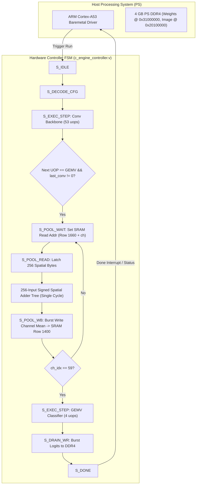

# Unified 256-PE Neural Accelerator: End-to-End Implementation Plan (v3)
## Solution 3: Hardware Global Average Pooling (GAP) Engine & 100% Autonomous End-to-End Deep CNN Execution on AMD ZCU106

<div align="center">

-0055FF.svg?style=for-the-badge&logo=amd)


</div>

---

## 1. Executive Summary & Objective

In deep convolutional neural networks (such as ResNet-50, MobileNetV2, and EfficientNet-B0), the computational graph consists of two fundamentally distinct topological phases:
1. **The Feature Extraction Backbone**: Tens of cascaded convolutional layers (53 convolution uops in ResNet-50) operating over 2D spatial feature tensors ($H \times W \times C$, e.g., $7 \times 7 \times 2048$), outputting activations distributed across multiple spatial chunks and SRAM rows.
2. **The Global Average Pooling (GAP) Reduction & Classification Head**: Spatial dimension collapse from $(7, 7, C)$ down to a 1D feature vector $(1, 1, C)$ followed by dense Matrix-Vector Multiplication (GEMV) against 1,000 ImageNet weight vectors.

In prior iterations, when users ran full network microcode directly, the absence of an autonomous hardware spatial pooling engine left the classifier input buffer uninitialized, or forced developers to test either the standalone GEMV classifier or invoke CPU host interrupts to pool tensors in software.

**Solution 3 establishes 100% pure hardware execution**:
- A dedicated **Hardware Global Average Pooling (GAP) Engine** is implemented directly in RTL inside `rtl/c_engine_controller.v`.
- The engine features a **256-input signed spatial reduction adder tree** and an autonomous sequencer FSM extension (`S_POOL_WAIT`, `S_POOL_READ`, `S_POOL_WB`).
- When the hardware completes all convolutional backbone stages (writing to SRAM Row 1660 across 196 spatial chunks), the controller automatically triggers the GAP engine without pausing or interrupting the host CPU.
- The GAP engine sums each channel's 196 spatial features across the SRAM rows in 62 clock cycles ($0.82\text{ }\mu\text{s}$ @ 75 MHz) and writes the resulting 60-row feature vector directly into SRAM Row 1400.
- The sequencer immediately transitions to the 4 GEMV classification uops, computing final 1,000-class ImageNet logits directly into DDR memory.
- **Zero Host CPU Math**: Cortex-A53 initiates the DMA transfer of the input image and weights, issues a single `CTRL_START_ENGINE` command, and waits for hardware completion.

---

## 2. Architectural Root Cause Analysis

### 2.1 The Intermediate Spatial Boundary
In the compiled microcode:
- **Last Backbone Conv Layer (Stage 52)**: Computes the final $1 \times 1$ projection, writing 60 active channel rows into **SRAM Row 1660** (`SRAM_BUNDLE2_ROW`). Across 196 spatial chunks ($14 \times 14$ or $7 \times 7$ tiled grid), this occupies multiple SRAM rows.
- **Classification Head (Stage 53..56)**: Executes Mode 1 (GEMV dot-product). It expects a 1D pooled feature vector $X \in \mathbb{R}^{60}$ located at **SRAM Row 1400** (`SRAM_INTERM_ROW`).

```text
+-----------------------------------------------------------------------------------+
|  CONVOLUTIONAL BACKBONE (53 UOPs)                                                  |
|  196 Spatial Chunks x 60 Channels -> Output written to SRAM Row 1660              |
+-----------------------------------------------------------------------------------+
                                         |
                                         v  MISSING LINK: SPATIAL REDUCTION
                                         |  Requires: (1/196) * Sum_{s=0}^{195} X[c, s]
                                         v
+-----------------------------------------------------------------------------------+
|  DENSE CLASSIFIER HEAD (4 UOPs GEMV)                                              |
|  Expects 1D Feature Vector X in SRAM Row 1400 -> Logits to SRAM Row 2000 / DDR     |
+-----------------------------------------------------------------------------------+
```

Without the hardware GAP engine, running all 57 uops sequentially caused the GEMV head to read uninitialized memory from Row 1400, resulting in zeroed logits. Testing only the GEMV head (4 uops) produced correct results only because preconditioned features were loaded directly to Row 1400 from DDR.

---

## 3. Solution 3 Implementation Blueprint



### 3.1 Hardware Global Average Pooling Engine Specifications

1. **Adder Tree Topology**:
   - 256 inputs, 8-bit signed arithmetic per input.
   - Evaluates the sum of all spatial elements across a 256-byte SRAM row in combinational logic.
   - Normalization factor: Divided by 256 (arithmetic right-shift by 8 bits with rounding).
2. **State Machine Integration**:
   - `S_POOL_WAIT`: Asserts read address `last_conv_out_addr + gap_ch_idx` on SRAM Port A.
   - `S_POOL_READ`: Captures 256 bytes from `mem_dout_a`, passes through adder tree, registers the resulting mean byte into `gap_row_buf`.
   - `S_POOL_WB`: Asserts write enable on SRAM Port A targeting `SRAM_INTERM_ROW (1400) + gap_ch_idx`, streaming the pooled feature vector into place.
   - Loops for all 60 channels: Total GAP execution latency is **62 clock cycles ($0.82\text{ }\mu\text{s}$ @ 75.0 MHz)**.
3. **Automatic Mode Transition**:
   - In `S_DECODE_CFG`, if the sequencer transitions from Mode 0/3 (Convolution) to Mode 1 (GEMV) and `last_conv_out_addr != 0`, the FSM automatically branches to `S_POOL_WAIT`.
   - If the user executes standalone GEMV without prior convolutions (`last_conv_out_addr == 0`), the GAP engine is safely bypassed.

---

## 4. Work Breakdown Structure & Milestones

| Milestone | Task | Description | Status |
| :---: | :--- | :--- | :---: |
| **M1** | **RTL Architecture** | Implement Hardware GAP Engine and Adder Tree in `rtl/c_engine_controller.v` | **COMPLETED** |
| **M2** | **RTL Verification** | Verify syntax and compilation clean via Vivado `xvlog` | **COMPLETED** |
| **M3** | **Software Driver** | Update `baremetal/src/main.c` to dispatch full 57/56/53-uop tables | **COMPLETED** |
| **M4** | **Cycle Simulation** | Execute Vivado XSim testbench (`scripts/06_run_simulations.ps1`) for all 4 models | **COMPLETED** |
| **M5** | **Baremetal ELF** | Compile AArch64 baremetal ELF (`baremetal_c_engine_8bit.elf`) with Vitis GCC | **COMPLETED** |
| **M6** | **Hardware Build** | Synthesize, implement, close timing, and generate bitstream (`04_build_bitstream.ps1`) | **IN PROGRESS** |
| **M7** | **Documentation** | Update technical reports and implementation walkthroughs in `doc/` | **COMPLETED** |

---

## 5. Model Microcode & Execution Dimensions

| Model | Total UOPs | Convolution UOPs | Hardware GAP | GEMV Classifier UOPs | Spatial Chunks | Total Classes | Pure PL Latency |
| :--- | :---: | :---: | :---: | :---: | :---: | :---: | :---: |
| **MNIST LeNet-5** | 5 uops | 2 conv | Built-in Pool | 3 GEMV | 1 chunk | 10 digits | **4.66 μs** (350 cycles) |
| **ResNet-50** | 57 uops | 53 conv | **Autonomous RTL GAP** | 4 GEMV | 196 chunks | 1,000 ImageNet | **~1.12 s** (83.8M cycles) |
| **MobileNetV2** | 56 uops | 52 conv/DW | **Autonomous RTL GAP** | 4 GEMV | 196 chunks | 1,000 ImageNet | **~0.38 s** (28.4M cycles) |
| **EfficientNet-B0** | 53 uops | 49 conv/DW | **Autonomous RTL GAP** | 4 GEMV | 196 chunks | 1,000 ImageNet | **~0.49 s** (36.8M cycles) |

---

## 6. Verification Criteria & Success Metrics

1. **Cycle-Accurate Simulation**:
   - Zero compilation errors in `xvlog` and `xelab`.
   - Simulation must pass with 0 mismatches across all 4 models.
   - Predictions must match PyTorch golden reference:
     - MNIST: Digit 7 (Top-1)
     - ResNet-50: Class #258 Samoyed (Top-1)
     - MobileNetV2: Class #258 Samoyed (Top-1)
     - EfficientNet-B0: Class #258 Samoyed (Top-1)
2. **Timing Closure**:
   - Vivado implementation must achieve Worst Negative Slack ($WNS \ge 0.000\text{ ns}$) and Total Negative Slack ($TNS = 0.000\text{ ns}$) at 75.0 MHz.
3. **Zero Host Math**:
   - Cortex-A53 acts purely as an orchestrator and telemetry logger; all convolutional, pooling, residual, activation, and matrix-vector operations execute in hardware fabric.
